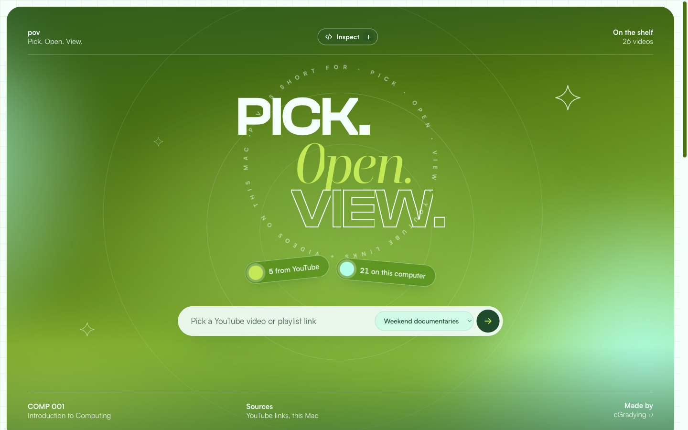

# pov: Pick. Open. View.



**pov** stands for **Pick. Open. View.** It is a personal viewing shelf, built as a
COMP 001 (Introduction to Computing) project: YouTube links and videos already on
your computer, in YouTube-style shelves, in a green "Green Screen" palette.

1. **Pick** a YouTube video or playlist link (or a clip from your own folders).
2. **Open** it from its card.
3. **View** it right on the page.

## Launch

```bash
cd "Code/Webpage"
node server.js        # or: npm start
```
Open http://localhost:3000. Needs Node 18+. No `npm install`.

Optional but already on this Mac:
- `yt-dlp`: reads YouTube details (duration, views, upload date) and whole playlists. Without it the site falls back to YouTube oEmbed (title + channel only).
- `ffmpeg` / `ffprobe`: thumbnails and durations for local videos. Without them local cards get a generic green thumbnail.

## How it works

| Source | What happens | What never happens |
|---|---|---|
| YouTube | Paste a video or playlist link. The server reads its details and saves them to `data/shelves.json`. Playback uses YouTube's own embed player. | No video is downloaded. |
| This computer | The server scans the folders in `config.json` (`.mp4 .mov .m4v .webm`, 4 folders deep) and streams each file from where it sits. | No file is copied, moved, or uploaded. |

Change which folders are scanned in `config.json`, then press **Rescan**.
**Shuffle** deals the local shelf in a random order.

## Inspect mode (how it works, live)

Press **I** (or the **Inspect** button) to x-ray the page:

- **Hover** any element: see its box (margin and padding), size, font, color, and its `data-*` / `aria-*` attributes.
- **Click** it: a panel opens with five tabs.
  - **HTML**: the live markup of that element.
  - **Styles**: every rule from `style.css` that applies to it.
  - **Data**: the JSON object the card was built from (straight from the server).
  - **Code**: the exact function in `app.js` that built it (`// #region` markers).
  - **API**: the endpoint that fed it and its handler in `server.js`.

Press **Esc** to close the panel, **Esc** again (or **I**) to leave Inspect mode.

## Type

| Role | Font | Source |
|---|---|---|
| Display (PICK. VIEW.) | Clash Display | [Fontshare](https://www.fontshare.com/fonts/clash-display) |
| Interface | Satoshi | [Fontshare](https://www.fontshare.com/fonts/satoshi) |
| Accent italic (Open.) | Boska | [Fontshare](https://www.fontshare.com/fonts/boska) |
| Handwritten notes | Reenie Beanie | [Google Fonts](https://fonts.google.com/specimen/Reenie+Beanie) |

Fonts load from the Fontshare and Google Fonts CDNs (no font files are stored in this repo).
If they are installed on your computer, the page uses the installed copies and works offline.

## Files

```
server.js         backend: API, folder scan, video streaming (Node built-ins only)
public/           frontend: index.html, style.css, app.js, inspect.js
config.json       port + folders to scan
data/shelves.json your YouTube shelves (created on first add)
cache/thumbs/     generated thumbnails (safe to delete)
test.js           node test.js
```

## API

```
GET    /api/shelves                      list YouTube shelves
POST   /api/shelves                      {title, subtitle} new shelf
DELETE /api/shelves/:id                  delete shelf
POST   /api/shelves/:id/youtube          {url} add video or playlist
DELETE /api/shelves/:id/videos/:videoId  remove one video
GET    /api/local[?shuffle][&rescan]     local videos
GET    /media/:id   /thumb/:id           stream file (Range supported) / thumbnail
GET    /source/server.js                 server source, for the Inspector's Code/API tabs
```

## Notes
- The server listens on 127.0.0.1 only, so nobody else on the network can browse your files.
- `.mov` clips shot on iPhone may use HEVC; if a browser can't play one, open the page in Safari.
